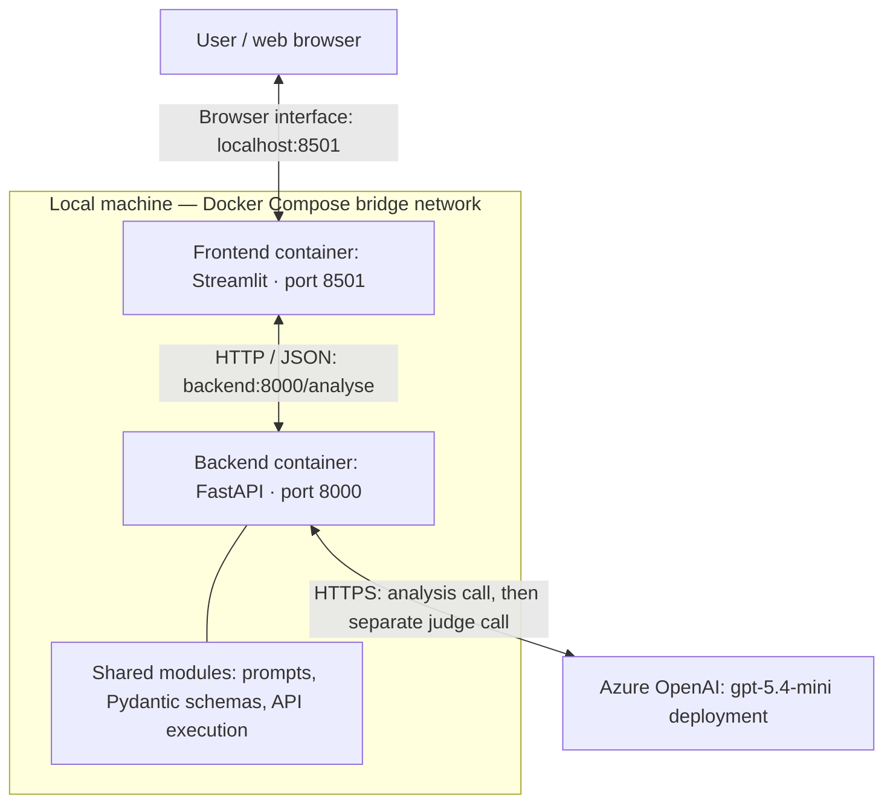

# Vegetarian Recipe and Allergen Assistant

Week 4 assessment: NLP, Transformers and Large Language Models.

## Contents

- [Project overview](#project-overview)
- [Features](#features)
- [Architecture](#architecture)
- [Project files](#project-files)
- [Prerequisites](#prerequisites)
- [Configuration](#configuration)
- [Run with Docker Compose](#run-with-docker-compose)
- [Run without Docker](#run-without-docker)
- [Use the application](#use-the-application)
- [API](#api)
- [Dataset and evaluation](#dataset-and-evaluation)
- [Troubleshooting](#troubleshooting)
- [Verification status](#verification-status)
- [Limits](#limits)
- [Prepare for GitHub submission](#prepare-for-github-submission)

## Project overview

An educational LLM application that extracts recipe information and suggests
a vegetarian substitution for a selected allergen. A separate LLM call reviews
the proposed answer for allergen removal, culinary workability and reporting.

## Features

- Extracts ingredients, confirmed and possible allergens, diet, preparation
  time and difficulty into Pydantic-validated JSON.
- Compares zero-shot, few-shot and structured checklist prompting.
- Uses checklist prompting in the application, selected from development results.
- Accepts an optional target allergen; otherwise selects a confirmed allergen
  alphabetically and explains the selection.
- Handles unstated preparation time and difficulty as unknown.
- Supports vegetarian recipes, including dairy and eggs, and vegan recipes.
  Flags clearly non-vegetarian or suitability-uncertain inputs.
- Provides five demo recipes in a collapsed helper with a load button.
- Runs FastAPI and Streamlit in separate containers through Docker Compose.

This application uses an existing Azure OpenAI deployment. No model is trained
or fine-tuned, and no RAG system is used.

## Architecture



The browser connects to Streamlit on port 8501. Streamlit sends recipe text and
the requested allergen to FastAPI. FastAPI calls Azure for analysis, validates
the response, then makes a separate judge call and validates its assessment.
It returns both results to Streamlit.

Inside Compose, Streamlit uses `http://backend:8000`. Only the backend receives
Azure credentials. The LLM itself runs in Azure, not inside either container.

| Component | Responsibility |
|---|---|
| Streamlit | Collect recipe input, load demo recipes and display results |
| FastAPI | Validate requests, coordinate the two LLM calls and return results |
| Pydantic | Check required fields, allowed labels and value types |
| Azure OpenAI | Produce the analysis and a separate judge assessment |
| Docker Compose | Start the two containers and provide service-name networking |
| Notebook | Compare prompts and inspect saved evaluation results |

Pydantic validates structure, not factual accuracy. The judge is a separate
request with different instructions, not a separately trained model.

## Project files

| File or folder | Purpose |
|---|---|
| `recipe_allergen_assessment.ipynb` | Explanations, experiments, evaluation and conclusions |
| `schemas.py` | Recipe and judge response schemas |
| `prompts.py` | Shared rules, three prompt builders and judge prompt |
| `experiments.py` | API execution, validation and measurements |
| `api.py` | FastAPI routes and application orchestration |
| `streamlit_app.py` | Recipe interface, helper examples and result display |
| `data/vegetarian_recipe_dataset_v1/` | Synthetic recipes, reference labels and annotation guide |
| `outputs/` | Saved experiment requests, responses and scores |
| `requirements-runtime.txt` | Pinned direct application dependencies |
| `pyproject.toml`, `uv.lock` | Project environment and dependency resolution |
| `Dockerfile`, `compose.yaml` | Container build and service definitions |
| `.dockerignore`, `.gitignore` | Build-context and Git exclusions |
| `.env.example` | Configuration template containing placeholders |

Run commands from the project root: the folder containing `compose.yaml`,
`api.py`, `pyproject.toml` and the `data` directory. The Docker image copies
application code and `demo.json`; it does not need the notebook or benchmark
reference files to serve requests.

## Prerequisites

### Docker route

- Docker Desktop installed and its engine running, with Linux containers enabled.
- An authorised Azure OpenAI endpoint, API key and deployment name.
- Project source files, `requirements-runtime.txt` and the demo dataset in place.
- Ports 8000 and 8501 available on the local computer.
- Internet access for the initial image/package downloads and subsequent Azure calls.

Python and uv are not required on the host merely to launch the existing Docker
configuration. The Python runtime is supplied by the image.

### Local Python and notebook route

- Python 3.13 and uv.
- VS Code with Python/Jupyter support, or another Jupyter-capable environment.
- The same Azure configuration as above.

The runtime dependency versions recorded from the working project were:

```text
fastapi==0.162.0
uvicorn==0.54.0
openai==3.40.0
python-dotenv==1.2.4
pydantic==2.14.1
streamlit==1.66.1
httpx==0.28.1
```

These are the project's recorded versions, not a recommendation to upgrade
to the newest releases. Use the committed requirements and lockfile.

## Configuration

Create a local `.env` in the project root using `.env.example` as a template.
Do not overwrite an existing working `.env`.

Set these values using your own Azure resource:

```dotenv
AZURE_OPENAI_ENDPOINT=https://YOUR_RESOURCE_NAME.openai.azure.com
AZURE_OPENAI_API_KEY=YOUR_AZURE_OPENAI_API_KEY
AZURE_OPENAI_DEPLOYMENT=YOUR_DEPLOYMENT_NAME
```

Supply the resource endpoint without `/openai/v1/`; the client appends that path.
The deployment value must match your Azure deployment name. The assessment
experiments used the deployment named `gpt-5.4-mini`.

`.env` is ignored by Git and excluded from Docker builds. Compose supplies it
to the backend at runtime. Never include real credentials in `.env.example`,
notebook outputs, screenshots or committed configuration.

If `.env` does not already exist, create it from the template in PowerShell:

```powershell
Copy-Item .env.example .env
```

Then edit `.env` locally with real values. Do not run this copy command over a
working configuration. Keep these rules in `.gitignore`:

```gitignore
.env
.env.*
!.env.example
.venv/
__pycache__/
.ipynb_checkpoints/
```

Use `.dockerignore` to exclude `.env`, `.env.*`, `.venv/`, `.git/`, notebook
files, caches and `outputs/` from the build context. Unlike `.gitignore`,
`.dockerignore` does not decide which files are committed.

## Run with Docker Compose

Prerequisites: Docker Desktop with the engine running, valid Azure configuration,
and network access to Azure and the package/image registries during build.

From the project root:

### Step 1 — Start Docker Desktop

Wait until the Docker engine is running. Stop local FastAPI and Streamlit
processes with Ctrl+C if they are using the same ports.

### Step 2 — Validate the Compose configuration

```powershell
docker compose config --quiet
```

No output normally means validation succeeded. Use the quiet option so resolved
environment values are not printed into terminal output.

### Step 3 — Build and start both services

```powershell
docker compose up --build -d
```

### Step 4 — Inspect service status

```powershell
docker compose ps
```

Expect a running frontend and a healthy backend. The first build can take longer
because it downloads the base image and installs dependencies.

### Step 5 — Open and exercise the app

Open:

- App: <http://localhost:8501>
- API process health: <http://127.0.0.1:8000/health>
- API documentation: <http://127.0.0.1:8000/docs>

Load a sample, click **Use this recipe**, then **Analyse recipe**. Confirm the
analysis and judge verdicts appear. This checks the complete path from Streamlit
through FastAPI to Azure; merely loading the page does not check that path.

Stop any locally running services on ports 8000 and 8501 before starting Compose.
The frontend waits for the backend process health check; this does not check Azure.
The ports are bound to the local machine. No public hosting is configured.

### Step 6 — Inspect logs or stop the services

```powershell
docker compose logs --tail 50 backend frontend
docker compose down
```

After changing application code, rebuild using `docker compose up --build -d`.
After changing `.env`, recreate the backend using
`docker compose up -d --force-recreate backend`.

## Run without Docker

Prerequisites: Python 3.13, uv and a configured `.env`.

### Step 1 — Restore the project environment

```powershell
uv sync
```

With a committed lockfile, `uv sync --locked` can be used to require that the
lockfile already matches the project configuration.

### Step 2 — Start FastAPI in Terminal 1

```powershell
uv run uvicorn api:app --reload --host 127.0.0.1 --port 8000
```

### Step 3 — Start Streamlit in Terminal 2

Leave Terminal 1 running. Open a second terminal in the same project root:

```powershell
uv run streamlit run streamlit_app.py
```

The frontend defaults to `http://127.0.0.1:8000`. Compose overrides this with
`API_URL=http://backend:8000` for container-to-container communication.

Both local services must run simultaneously. Stopping the backend while keeping
Streamlit open allows the UI to load but causes analysis requests to fail.

## Use the application

1. Paste recipe ingredients and instructions, or expand the sample helper.
2. Click **Use this recipe** to fill the input from a sample.
3. Choose a target allergen or leave auto-selection enabled.
4. Click **Analyse recipe** once.
5. Review the original recipe information, proposed adaptation, remaining and
   introduced allergens, notes and individual judge verdicts.

Loading examples does not call Azure. A successful analysis normally makes
two calls: analysis and judging. Editing inputs clears old results. A frontend
timeout does not necessarily cancel backend processing; avoid immediate repeats.

## API

| Endpoint | Behaviour |
|---|---|
| `GET /health` | Returns process health without calling Azure |
| `POST /analyse` | Accepts recipe text and an optional target; returns analysis and judge assessment |
| `GET /docs` | Interactive API documentation |

Example request:

```json
{
  "recipe_text": "Cucumber salad. Ingredients: cucumber, lemon juice, salt. Method: Slice cucumber and toss with lemon and salt.",
  "target_allergen": null
}
```

To try the request in a browser, open `/docs`, expand **POST /analyse**, click
**Try it out**, paste the JSON and click **Execute** once. This makes live Azure
requests. GET `/health` does not.

The response contains `analysis`, nullable `judge`, and `judge_status`.
`judge_status: "valid"` means the judge output passed schema validation, not
that it approved the substitution. Judge failure leaves an explicit unavailable
assessment. Invalid recipe analysis returns HTTP 502; missing configuration
returns HTTP 503; invalid request fields normally return HTTP 422.

## Dataset and evaluation

All recipes and labels were AI-authored for this assessment. They are synthetic,
consistency-checked reference data, not an independently expert-reviewed benchmark.
See the dataset README for annotation rules and limitations.

The supplied files contain 4 prompt examples, 13 development recipes, 13 test
recipes and 5 demos. To keep the assessment manageable, the executed scope was:

- First 3 prompt examples used for few-shot prompting.
- Development IDs 01, 02, 09, 10, 11 and 12: 6 recipes x 3 techniques = 18 analyses.
- Test IDs 08, 10 and 11: 3 analyses with the selected checklist prompt.
- Demo recipes kept separate from the evaluation recipes.

The same deployment, recipe inputs and output schema were used across techniques.
Checklist instructions were refined using exploratory development observations;
the comparison is not a controlled estimate of the prompting style alone.

API attempts have automatic retries disabled. Original responses, failures,
timing, token usage and request definitions are saved. Unchanged batch reruns
skip saved attempts, including failures. Changed request definitions create new
result folders. Earlier exploratory cells can make new calls if rerun.

### Development results

Counts below are out of six original attempts per technique.

| Technique | Schema-valid | Confirmed allergens correct | Diet correct | Prep time correct | Difficulty correct | Judge-approved answers |
|---|---:|---:|---:|---:|---:|---:|
| Zero-shot | 5 | 5 | 4 | 5 | 5 | 2 |
| Few-shot | 6 | 6 | 6 | 6 | 6 | 3 |
| Checklist | 6 | 6 | 6 | 6 | 6 | 4 |

Allergen scoring uses exact set equality. The other extraction scores use exact
reference matches, including null for unstated values. Invalid analyses receive
no successful field scores because the application cannot accept them; this is
an application-level scoring choice, not a claim that every raw field was wrong.

The judge used a fixed rubric and a separate call to the same deployment.
It received the original input and candidate answer, without the technique name
or reference substitution. All 17 schema-valid development answers were judged;
one trial was reused. All 17 judge responses passed their schema.

Judge approval requires all applicable checks to pass. No-substitution answers
are assessed for correct withholding and reporting, so approved counts include
those cases, not just successful substitutions. Uncertainty is not approval.
Manual review found weak or partly incorrect judge objections. Original scores
were preserved, with qualifications recorded separately in the notebook.

### Selection and held-out results

Checklist prompting was selected because it matched all measured development
extraction fields, had no schema failures, and had the highest recorded judge
approval. This is a practical choice for the assessment, not proof of superiority.

On three held-out recipes, checklist achieved 3/3 for schema validity, confirmed
allergens, diet, preparation time and difficulty. Test substitutions were manually
inspected; no separate held-out judge score is claimed. The selected prompt was
not tuned after inspecting these results.

Observed limitations included confusing cross-contact wording and an unsupported
assumption that a replacement couscous product uses identical hydration instructions.
The app also demonstrated a judge challenge to an ambiguous tamari-style option.

### Reproduce or inspect experiments

Open the notebook from the project root and select the project's `.venv` Python
kernel, rather than a separate global Python installation. Run cells in order.
Saved cell output does not recreate Python variables after a kernel restart.

Inspection and scoring cells use existing data without API calls. Connection,
exploratory analysis, experiment and judge cells may incur Azure usage. For the
recorded development run, results are under
`outputs/development_comparison_a7418792c152/`; final test results are under
`outputs/final_test_6700715e5cce/`. Fresh executions can produce different outputs.

## Troubleshooting

| Symptom | What to check or do |
|---|---|
| UI says it cannot reach the backend | In local mode, keep both service terminals running and open `/health`. In Docker mode, inspect `docker compose ps` and backend logs. |
| UI loads but analysis fails in Docker | Confirm the frontend uses `API_URL=http://backend:8000`; `localhost` inside that container refers to itself. |
| Port already allocated | Stop the locally running service on port 8000 or 8501 before starting Compose. |
| Docker daemon connection error | Start Docker Desktop and wait for the engine to become available. |
| HTTP 503 from `/analyse` | Check the backend's Azure variables in `.env`; recreate the backend after edits. Do not print API keys while diagnosing. |
| HTTP 502 from `/analyse` | The analysis call failed, was incomplete, was refused or did not pass its schema. The current API deliberately returns a generic message; it does not expose the upstream error. |
| HTTP 422 from `/analyse` | Check request fields, text length and canonical target-allergen values against `/docs`. |
| `/` or `/favicon.ico` returns 404 | Those routes are not defined. Use `/health`, `/docs` or the Streamlit interface. |
| `ModuleNotFoundError: prompts` | Save `prompts.py` beside the notebook and check the notebook working directory and kernel. |
| `NameError: development_recipes` | Run the earlier loading cell. A restarted kernel loses variables even when old output remains visible. |
| Notebook cannot find FastAPI but the app runs | The notebook may use global Python rather than the uv project environment. Select the project's `.venv` kernel. |
| An edited prompt appears unchanged | Save the file and reload the module in the notebook, or restart the relevant service. Rebuild Docker images after code edits. |
| Output appears truncated in Jupyter | Display selected fields in a new cell. Do not rerun API calls merely to view an existing response. |
| Judge review is unavailable | Inspect `judge_status` in the JSON expander. A validated analysis can still be returned when judging fails. |
| Judge rejects a schema-valid response | This is expected: structure and correctness are separate. Review the explanation and candidate ingredients manually. |


## Verification status

- Dataset loading and structural checks completed.
- Pydantic accepted a valid example and rejected invalid diet, negative time
  and missing required-field examples.
- Azure connection and recorded experiments completed.
- Local FastAPI health and analysis requests succeeded.
- Local Streamlit interaction and judge display were exercised.
- Compose showed both services running and the backend healthy; the Docker UI loaded.
- Final confirmation of a recipe analysis plus judge review through the Docker
  UI is still pending at the time this README was prepared.
- Architecture and presentation content have been prepared. GitHub publication
  and the final presentation have not been confirmed in this record.

## Limits

This is an educational prototype, not an allergy-safety certification tool.
Product ingredients and cross-contamination require separate checking. Vegetarian
does not mean allergen-free. Removing one allergen may leave or introduce others.

The evaluation uses six development and three test recipes, with one recorded
attempt per recipe/technique. It does not establish statistical reliability,
latency superiority or full coverage of every allergen category. The schemas
use a UK-14-aligned vocabulary; the evaluated subset does not cover all categories
and this project does not claim regulatory compliance.

Ingredient extraction and possible-allergen reasoning were not comprehensively
scored in the reported extraction table. Difficulty was extracted when stated,
not independently estimated. Both the assistant and same-model judge can make
mistakes. Judge failures are displayed but do not automatically repair answers.

Direct runtime dependencies are version-pinned; transitive dependencies and the
base image are not completely frozen by `requirements-runtime.txt` alone.


### Final checklist

- Complete the final Docker recipe check and update verification status.
- Save the executed notebook and final conclusion.
- Keep the labelled data and relevant synthetic evaluation outputs in the repository.
- Verify `.env` is ignored and untracked; commit only placeholder configuration.
- Review staged files, push to GitHub and add the repository link to the assessment card.
- Prepare the presentation and a short demonstration using the sample helper.
